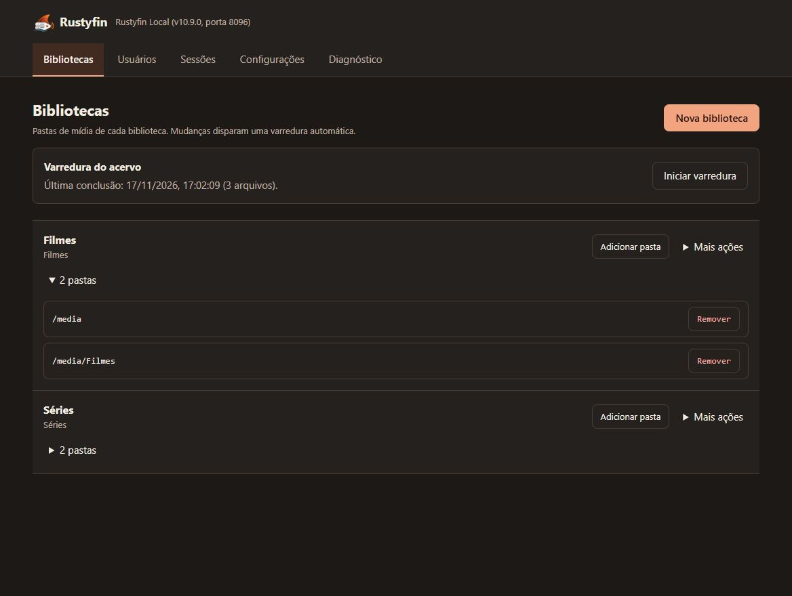
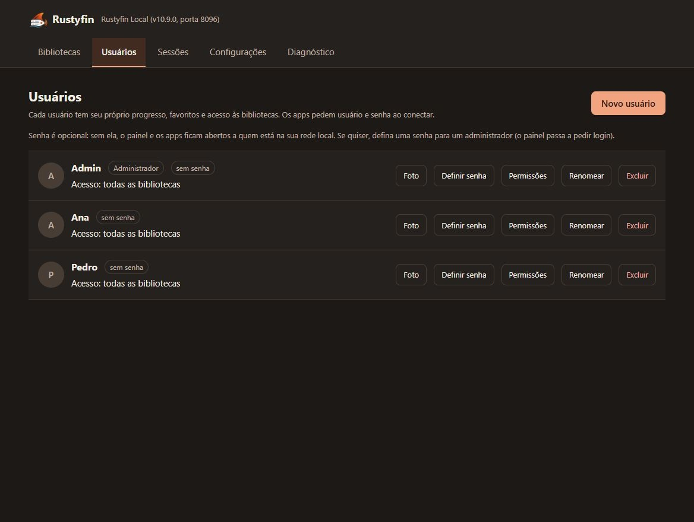
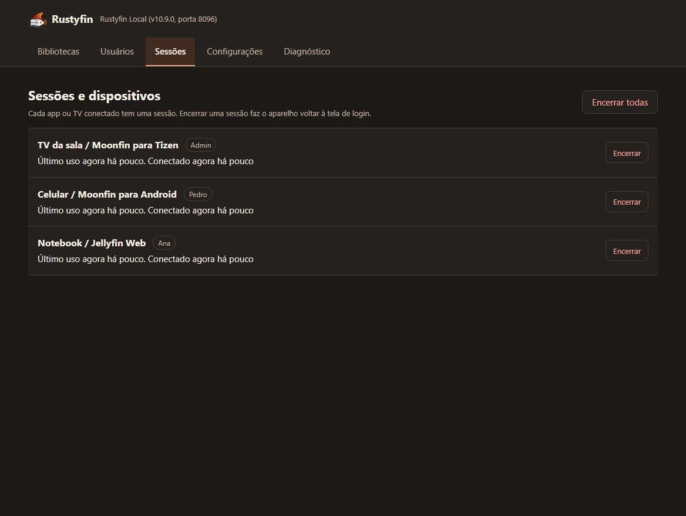
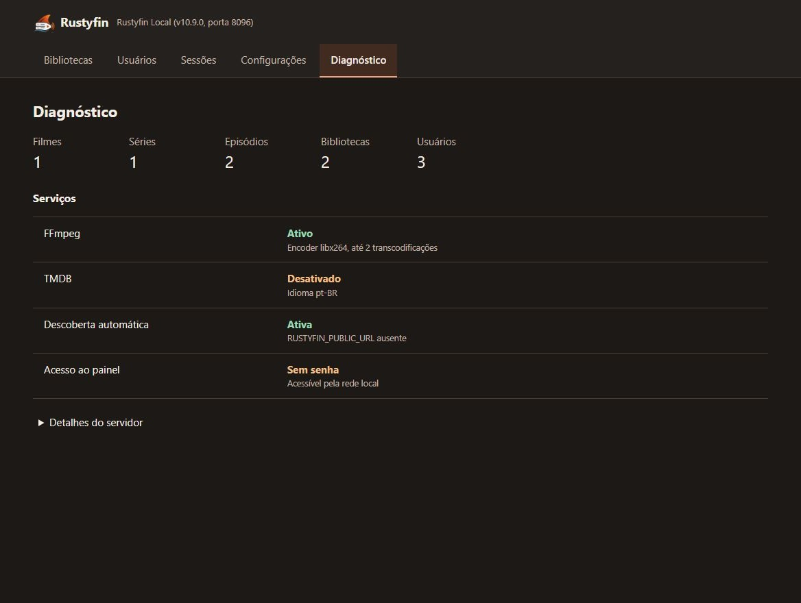

<div align="center">

<picture>
  <source media="(prefers-color-scheme: dark)" srcset="docs/assets/logo-dark.png">
  
</picture>

### Servidor de mídia ultraleve em Rust, compatível com os apps do Jellyfin

[](https://github.com/mensonones/rustyfin/actions/workflows/rust-tests.yml)
[](LICENSE)
[](https://www.rust-lang.org/)
[](CHANGELOG.md)

[Início rápido](#início-rápido) ·
[Recursos](#recursos) ·
[Compatibilidade](#compatibilidade) ·
[Documentação](#documentação) ·
[Contribuindo](#contribuindo)

</div>

---

O **Rustyfin** é um servidor de mídia para a sua rede local. Ele fala a API do Jellyfin, então os apps que você já usa
(**Moonfin**, **Swiftfin**, **Findroid**) funcionam sem mudanças. Em troca, é um único binário em Rust com SQLite, que
sobe em segundos e usa **poucas dezenas de megabytes de memória**.

| | Rustyfin | Jellyfin 12.4 |
|---|---|---|
| Memória após indexar e usar | ~16 MiB | ~440 MiB |
| Imagem Docker | 785 MB | 2,49 GB |
| Varredura de 18 vídeos (~30 GB) | 0,55 s | 52,7 s |
| Direct Play, 1 stream | 183 MB/s | 95 MB/s |

> Números de uma rodada na mesma máquina, com a mesma biblioteca e sem metadados online. São indicativos, não um
> estudo estatístico. Metodologia e ressalvas em [docs/desempenho.md](docs/desempenho.md).

## Recursos

**Biblioteca**
- Varredura automática e paralela, mais monitoramento de pastas em tempo real (novos arquivos aparecem em segundos).
- Filmes e séries (Série → Temporada → Episódio), com "Continuar assistindo", "Próximo episódio" e contagem de não assistidos.
- Metadados do **TMDB** (opcional): sinopse, nota, gêneros, elenco com fotos, estúdios, classificação indicativa, trailers e arte.
  Imagens locais (`poster.jpg`, `fanart.jpg`, `folder.jpg`) têm prioridade.
- Reconhece nomes comuns de arquivo: `Filme (2020).mkv`, `Serie S01E02.mkv`, `Serie/Season 1/...`.

**Reprodução**
- **Direct Play** com `Range` (avanço e retrocesso instantâneos), **Remux** e **Transcode** sob demanda, escolhidos pelo
  `DeviceProfile` que o app envia.
- **HLS** (MPEG-TS e fMP4) com avanço livre, duas qualidades (ABR) e conversão de HDR para SDR.
- Legendas SRT/ASS/VTT, externas ou embutidas; legendas de imagem (PGS/DVD) são queimadas no vídeo.

**Administração**
- Painel web em `/admin`: bibliotecas, usuários e permissões, dispositivos conectados e configurações, sem reiniciar.
- Vários usuários, cada um com progresso e favoritos próprios, acesso por biblioteca, foto de perfil e perfil oculto.
- Descoberta automática na rede (UDP 7359): o app encontra o servidor sozinho.

## Compatibilidade

| Cliente | Situação |
|---|---|
| **Moonfin** para Android | Testado: login, bibliotecas, Direct Play, HLS, legendas e descoberta automática |
| **Moonfin** para Samsung (Tizen) | Testado: Direct Play e avanço |
| **Swiftfin**, **Findroid** | Esperado funcionar, ainda sem validação em aparelho |
| Simulador (`tools/client_probe.py`) | 63 rotas do fluxo de um app Jellyfin respondem corretamente |

Veja [docs/clientes.md](docs/clientes.md) para o passo a passo de cada app e as particularidades de cada um.

## Início rápido

### Docker (recomendado)

A imagem já inclui o `ffmpeg`.

```bash
git clone https://github.com/mensonones/rustyfin.git
cd rustyfin
cp .env.example .env       # ajuste o IP do PC em RUSTYFIN_PUBLIC_URL
docker compose up -d --build
```

Coloque os vídeos em `./media` (ou monte outra pasta em `docker-compose.yml`) e abra
**http://localhost:8096/admin** para criar as bibliotecas. Nos apps, use o endereço `http://<ip-do-pc>:8096`
e o usuário `Admin` (sem senha na rede local).

> No Docker, o container só enxerga as pastas **montadas como volume**.
> Veja [docs/configuracao.md](docs/configuracao.md#usando-pastas-do-seu-pc-no-docker).

### Compilando

Requer Rust 1.85 ou mais novo e, para transcodificar e ler codecs, `ffmpeg`/`ffprobe` no `PATH`.

```bash
cargo run --release
```

## Painel de administração

<table>
  <tr>
    <td></td>
    <td></td>
  </tr>
  <tr>
    <td></td>
    <td></td>
  </tr>
</table>

O painel só é acessível pela rede local e pode exigir senha. Detalhes em
[docs/usuarios-e-seguranca.md](docs/usuarios-e-seguranca.md).

## Documentação

| Documento | Conteúdo |
|---|---|
| [Configuração](docs/configuracao.md) | Variáveis de ambiente, configurações do painel, pastas, TMDB e nomes de arquivo |
| [Usuários e segurança](docs/usuarios-e-seguranca.md) | Contas, senhas, tokens, sessões, acesso por biblioteca e o que é público |
| [Reprodução](docs/reproducao.md) | Direct Play, remux, transcode, HLS, legendas e HDR |
| [Clientes](docs/clientes.md) | Como conectar cada app e o que foi testado |
| [Arquitetura](docs/arquitetura.md) | Módulos, fluxo de uma requisição, banco de dados e caches |
| [API](docs/api.md) | Rotas do Jellyfin suportadas e a API do painel |
| [Solução de problemas](docs/solucao-de-problemas.md) | Descoberta no Docker, TV, permissões, desempenho |
| [Desempenho](docs/desempenho.md) | Comparativo com o Jellyfin e metodologia |
| [Desenvolvimento](docs/desenvolvimento.md) | Build, testes, estrutura do código e versões |
| [Roadmap](ROADMAP.md) · [Changelog](CHANGELOG.md) | O que existe, o que falta e o histórico de versões |

## Contribuindo

Contribuições são bem-vindas. Leia o [guia de contribuição](CONTRIBUTING.md) (padrão de commits e versões) e o
[guia de desenvolvimento](docs/desenvolvimento.md). Agentes de IA seguem o [`AGENTS.md`](AGENTS.md).

```bash
cargo clippy --locked --all-targets -- -D warnings
cargo test --locked
```

## Licença e créditos

Distribuído sob a licença [MIT](LICENSE).

O Rustyfin é um projeto independente e **não é afiliado nem endossado** pelo projeto Jellyfin. Ele implementa um
subconjunto compatível da API pública para funcionar com os apps do ecossistema.
Os metadados vêm do TMDB: *este produto usa a API do TMDB, mas não é endossado nem certificado por ele*.

<div align="center">

<sub>Feito com 🦀 Rust, Axum, Tokio e SQLite</sub>

</div>
