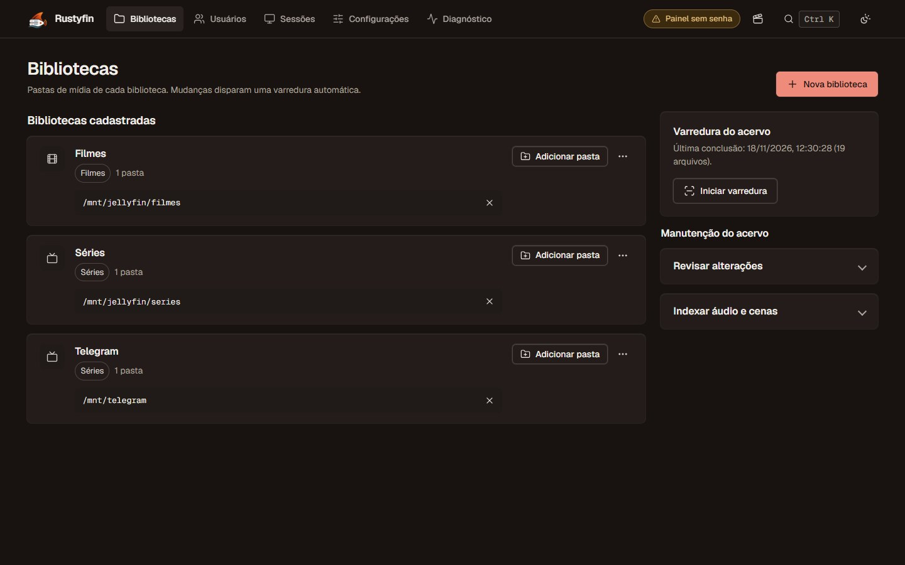
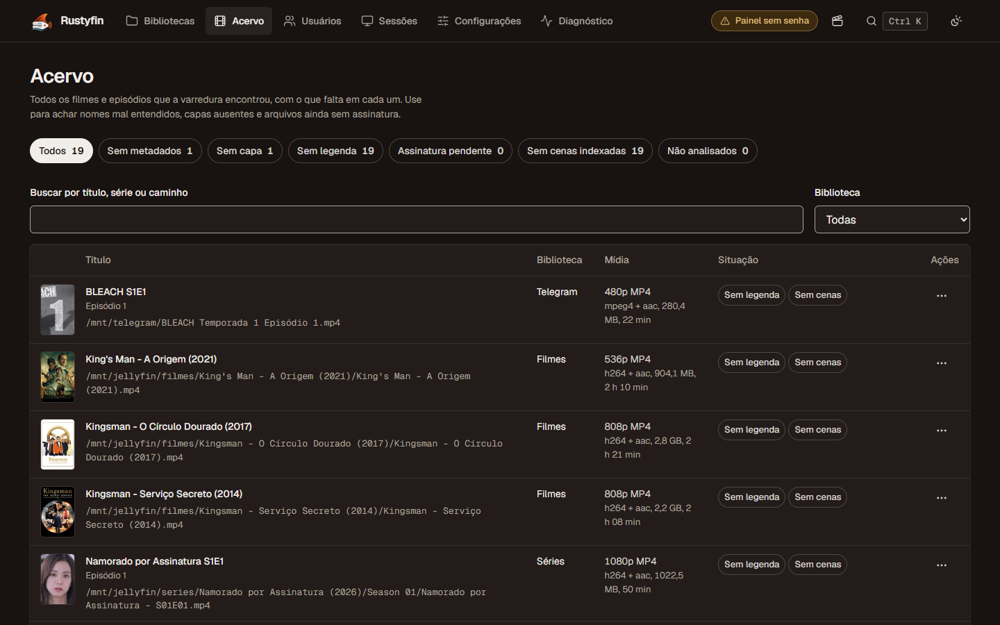
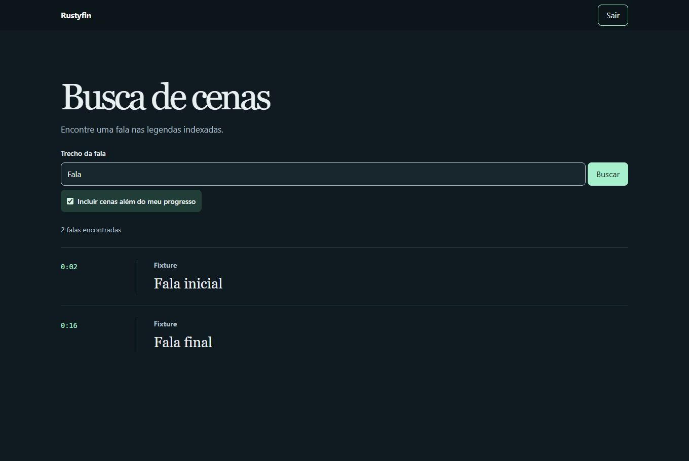

<div align="center">

<picture>
  <source media="(prefers-color-scheme: dark)" srcset="docs/assets/logo-dark.png">
  
</picture>

### Servidor de mídia ultraleve em Rust, compatível com os apps do Jellyfin

[](https://github.com/mensonones/rustyfin/actions/workflows/rust-tests.yml)
[](LICENSE)
[](https://www.rust-lang.org/)
[](CHANGELOG.md)

[Início rápido](#início-rápido) ·
[Por que usar](#por-que-usar) ·
[Recursos](#recursos) ·
[Compatibilidade](#compatibilidade) ·
[Documentação](#documentação) ·
[Contribuindo](#contribuindo)

</div>

---

O **Rustyfin** é um servidor de mídia para a sua rede local. Ele fala a API do Jellyfin, então os apps que você já usa
(**Moonfin**, **Swiftfin**, **Findroid**) funcionam sem mudanças. Em troca, é um único binário em Rust com SQLite, que
sobe em segundos e usa **poucas dezenas de megabytes de memória**.

| | Rustyfin | Jellyfin 12.4 |
|---|---|---|
| Memória em repouso (biblioteca indexada) | 11 MiB (9 MiB com 1 CPU) | 391 MiB (374 MiB) |
| Imagem Docker | 791 MB | 2,49 GB |
| Subida até a API responder | 0,6 s | 6,0 s |
| Reinício a quente | 0,8 s | 2,6 s |
| 1ª varredura de 30 GB | 3,0 s | 57,7 s |
| API, 1 conexão (p50) | 1,4 a 2,1 ms | 12 a 32 ms |
| Direct Play, 1 stream | 182 MB/s | 78 MB/s |
| Transcodificação, 1 sessão | 14,0× tempo real | 12,2× |
| Varredura de 1.000 arquivos numa pasta | 15 s | 413 s |

> Medido em 17 e 18/11/2026 (Rustyfin v0.17.5, 4 CPUs, mesma biblioteca, sem metadados online). Em um container com
> **1 CPU e 512 MB** o Rustyfin também vence em tudo o que foi medido. Só na transcodificação com 4 sessões simultâneas os
> dois empatam. Números, metodologia, ressalvas e as correções feitas a partir do teste em
> [docs/desempenho.md](docs/desempenho.md).

## Por que usar

- **Leve de verdade.** Cerca de 10 MB de memória em repouso e menos de um segundo para subir. Roda sem notar em um mini
  PC, em um NAS ou ao lado de outros serviços.
- **Seus apps de sempre.** Moonfin, Swiftfin e Findroid conectam como em um Jellyfin. Nada para instalar no celular ou na TV.
- **Instalação em três comandos**, com Docker, `ffmpeg` e drivers de GPU Intel já na imagem. Sem banco para configurar, sem
  plugin para instalar.
- **GPU Intel e AMD sem dor de cabeça.** Um script liga o Quick Sync ou o VAAPI; se a GPU falhar, o servidor volta para o
  processador sozinho.
- **Recursos que o Jellyfin não tem:** [busca de cenas](docs/reproducao.md#áudio-cenas-e-versões-preparadas) por fala,
  [ajuste de legendas](docs/reproducao.md#corrigir-uma-faixa-srt) no painel e
  [revisão do acervo](docs/arquitetura.md#revisar-alterações-do-acervo) que preserva favoritos e progresso ao trocar a edição.
- **Seus arquivos ficam intactos.** Monte as pastas em somente leitura e o servidor só lê.

Quer saber o que muda e o que falta? Leia [Migrando do Jellyfin](docs/migrando-do-jellyfin.md): ele diz quando **não**
vale a pena trocar.

## Recursos

**Biblioteca**
- Varredura automática e paralela, mais monitoramento de pastas em tempo real (novos arquivos aparecem em segundos).
- Filmes e séries (Série → Temporada → Episódio), com "Continuar assistindo", "Próximo episódio" e contagem de não assistidos.
- Metadados do **TMDB** (opcional): sinopse, nota, gêneros, elenco com fotos, estúdios, classificação indicativa, trailers e arte.
  Imagens locais (`poster.jpg`, `fanart.jpg`, `folder.jpg`) têm prioridade.
- Reconhece nomes comuns de arquivo: `Filme (2020).mkv`, `Serie S01E02.mkv`, `Serie/Season 1/...`.

**Reprodução**
- **Direct Play** com `Range` (avanço e retrocesso instantâneos), **Remux** e **Transcode** sob demanda, escolhidos pelo
  `DeviceProfile` que o app envia.
- **HLS** (MPEG-TS e fMP4) com avanço livre, duas qualidades (ABR) e conversão de HDR para SDR.
- [Aceleração por hardware](docs/reproducao.md#aceleração-por-hardware) com GPU Intel ou AMD (VAAPI no Linux, Quick Sync no
  Windows), decodificando e codificando na GPU: detectada sozinha e com volta automática para o processador. Medido numa Intel
  UHD: ~11× o tempo real usando ~21% da CPU, contra ~7× e ~85% do `libx264`.
- Legendas SRT/ASS/VTT, externas ou embutidas; legendas de imagem (PGS/DVD) são queimadas no vídeo.
- [Ajuste de legendas SRT](docs/reproducao.md#corrigir-uma-faixa-srt) no painel, com atraso fixo e desvio progressivo por dois pontos.

**Administração**
- Painel web em `/admin` com tema claro/escuro, paleta de comandos (Ctrl K) e avisos do que precisa de atenção: bibliotecas, usuários e permissões, dispositivos conectados e configurações, sem reiniciar.
- [Revisão de alterações do acervo](docs/arquitetura.md#revisar-alterações-do-acervo) para transferir favoritos, marcações de assistido e posições de retomada entre edições.
- Vários usuários, cada um com progresso e favoritos próprios, acesso por biblioteca, foto de perfil e perfil oculto.
- Descoberta automática na rede (UDP 7359): o app encontra o servidor sozinho.

## Compatibilidade

| Cliente | Situação |
|---|---|
| **Moonfin** para Android | Testado: login, bibliotecas, Direct Play, HLS, legendas e descoberta automática |
| **Moonfin** para Samsung (Tizen) | Testado: Direct Play e avanço |
| **Swiftfin**, **Findroid** | Esperado funcionar, ainda sem validação em aparelho |
| Simulador (`tools/client_probe.py`) | 63 rotas do fluxo de um app Jellyfin respondem corretamente |

Veja [docs/clientes.md](docs/clientes.md) para o passo a passo de cada app e as particularidades de cada um.

## Início rápido

Você precisa do **Docker** e de uma pasta com vídeos. A imagem já inclui o `ffmpeg`.

```bash
git clone https://github.com/mensonones/rustyfin.git
cd rustyfin
cp .env.example .env       # troque o IP pelo do seu PC em RUSTYFIN_PUBLIC_URL
docker compose up -d --build
```

Depois:

1. **Mostre seus vídeos ao container.** Ele só enxerga pastas montadas como volume. Crie um `docker-compose.override.yml`
   com `- "D:/Videos:/mnt/videos:ro"` em `volumes` (ou coloque os arquivos em `./media`).
2. Abra **http://localhost:8096/admin**, crie as bibliotecas e aponte para `/mnt/videos`.
3. No app, adicione `http://<ip-do-pc>:8096` (ou use a descoberta automática) e entre como **`Admin`**, sem senha na rede
   local.

O passo a passo completo, com Windows, firewall, senha, TMDB, GPU, atualização e backup, está em
**[Primeiros passos](docs/primeiros-passos.md)**.

**Qual perfil é o melhor na sua máquina?** `python tools/perfil/escolher_perfil.py` mede Docker e nativo, com e sem GPU, e
recomenda um ([como ler](docs/escolher-perfil.md)). No Windows com GPU Intel, rodar direto (sem Docker) com Quick Sync foi
1,6× mais rápido e usou cerca de 20× menos CPU.

**GPU Intel ou AMD no Linux:** rode `sh tools/gpu-setup.sh` antes do `docker compose up -d`
([detalhes](docs/reproducao.md#aceleração-por-hardware)). No Docker Desktop do Windows a GPU Intel não é repassada;
rodando o Rustyfin direto no Windows o Quick Sync funciona ([como](docs/reproducao.md#windows)).

### Compilando

Requer Rust 1.85 ou mais novo e, para transcodificar e ler codecs, `ffmpeg`/`ffprobe` no `PATH`.

```bash
cargo run --release
```

## Painel de administração



Bibliotecas, acervo, usuários, sessões, configurações e diagnóstico, com tema claro e escuro e paleta de comandos (`Ctrl K`).
O painel só é acessível pela rede local e pode exigir senha. Detalhes em
[docs/usuarios-e-seguranca.md](docs/usuarios-e-seguranca.md).

### Acervo



A aba **Acervo** lista todos os filmes e episódios que a varredura encontrou, com a capa de cada um, e mostra o que falta: metadados,
capa, legenda, assinatura e cenas indexadas. Filtre por problema, busque por título ou caminho e rode as ações (indexar
cenas e áudio, ajustar legenda) direto na linha. Serve para achar um nome mal entendido ou uma capa ausente sem abrir o app.

## Busca de cenas



Lembra de uma fala, mas não do filme? Em `/cenas`, entre com o seu perfil e procure pelo trecho: o Rustyfin mostra o título
e o minuto, e esconde o que você ainda não assistiu. Como indexar as legendas:
[reprodução](docs/reproducao.md#áudio-cenas-e-versões-preparadas).

## Documentação

| Documento | Conteúdo |
|---|---|
| [Primeiros passos](docs/primeiros-passos.md) | Do zero ao primeiro filme: Docker, pastas, painel, app, atualização e backup |
| [Migrando do Jellyfin](docs/migrando-do-jellyfin.md) | O que você ganha, o que perde e como testar lado a lado |
| [Configuração](docs/configuracao.md) | Variáveis de ambiente, configurações do painel, pastas, TMDB e nomes de arquivo |
| [Usuários e segurança](docs/usuarios-e-seguranca.md) | Contas, senhas, tokens, sessões, acesso por biblioteca e o que é público |
| [Qual perfil escolher](docs/escolher-perfil.md) | Docker ou nativo, com ou sem GPU: o que medir, o que escolher e o script que decide |
| [Guia para LLM](docs/guia-llm.md) | Procedimento para um assistente de IA medir a máquina e recomendar o perfil |
| [Reprodução](docs/reproducao.md) | Direct Play, remux, transcode, HLS, legendas e HDR |
| [Clientes](docs/clientes.md) | Como conectar cada app e o que foi testado |
| [Arquitetura](docs/arquitetura.md) | Módulos, fluxo de uma requisição, banco de dados e caches |
| [API](docs/api.md) | Rotas do Jellyfin suportadas e a API do painel |
| [Solução de problemas](docs/solucao-de-problemas.md) | Descoberta no Docker, TV, permissões, desempenho |
| [Desempenho](docs/desempenho.md) | Comparativo com o Jellyfin e metodologia |
| [Desenvolvimento](docs/desenvolvimento.md) | Build, testes, estrutura do código e versões |
| [Roadmap](ROADMAP.md) · [Changelog](CHANGELOG.md) | O que existe, o que falta e o histórico de versões |

## Contribuindo

Contribuições são bem-vindas. Leia o [guia de contribuição](CONTRIBUTING.md) (padrão de commits e versões) e o
[guia de desenvolvimento](docs/desenvolvimento.md). Agentes de IA seguem o [`AGENTS.md`](AGENTS.md).

```bash
cargo clippy --locked --all-targets -- -D warnings
cargo test --locked
```

## Licença e créditos

Distribuído sob a licença [MIT](LICENSE).

O Rustyfin é um projeto independente e **não é afiliado nem endossado** pelo projeto Jellyfin. Ele implementa um
subconjunto compatível da API pública para funcionar com os apps do ecossistema.
Os metadados vêm do TMDB: *este produto usa a API do TMDB, mas não é endossado nem certificado por ele*.

<div align="center">

<sub>Feito com 🦀 Rust, Axum, Tokio e SQLite</sub>

</div>
