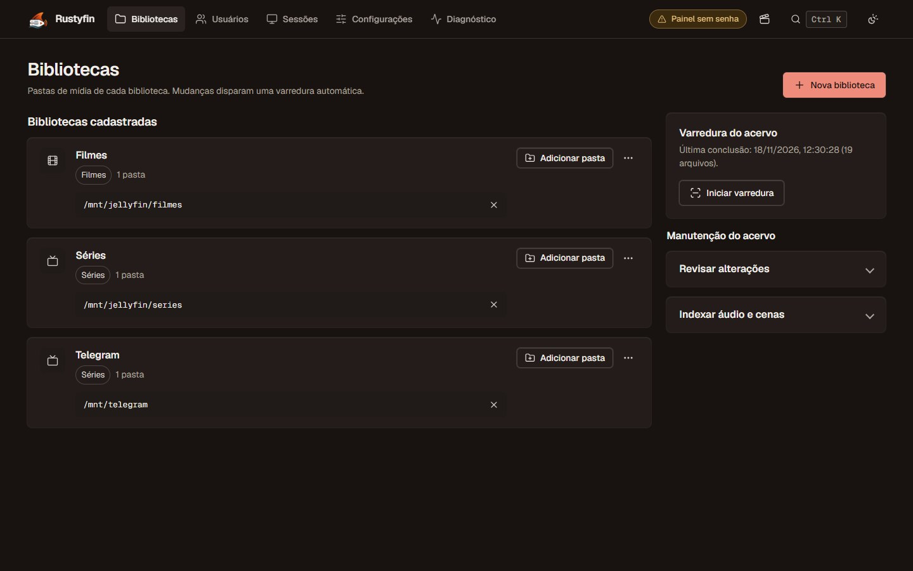

# Primeiros passos

Este guia leva você do zero a assistir um filme no celular ou na TV em cerca de dez minutos. Ele usa **Docker**, que é o
jeito recomendado: a imagem já traz o `ffmpeg` e os drivers de GPU Intel, e nada é instalado no seu sistema.

## O que você precisa

| Item | Detalhe |
|---|---|
| **Docker** com o Compose | Docker Desktop (Windows e macOS) ou Docker Engine (Linux). Confira com `docker compose version` |
| **Uma pasta com vídeos** | Filmes e séries em qualquer lugar do PC ou de um disco de rede |
| **Um app compatível** | Moonfin, Swiftfin ou Findroid, no celular ou na TV, na **mesma rede** do servidor |
| Memória | Cerca de 10 MB em repouso, o que cabe em qualquer PC ou mini PC |

## 1. Baixe e configure

```bash
git clone https://github.com/mensonones/rustyfin.git
cd rustyfin
cp .env.example .env
```

Abra o arquivo `.env` e troque o IP pelo **IP do seu PC na rede** (`ipconfig` no Windows, `ip addr` no Linux):

```env
RUSTYFIN_PUBLIC_URL=http://192.168.1.10:8096
```

Esse endereço é o que o servidor anuncia aos apps na descoberta automática. Dentro do Docker o servidor não sabe qual é o
IP do PC, por isso você precisa dizer.

## 2. Mostre suas mídias ao container

O container só enxerga as pastas que **você montar como volume**. Esta é a causa número um de "a biblioteca está vazia".
Escolha uma das formas:

**A. Colocar os vídeos em `./media`**, dentro da pasta do projeto. Não precisa mexer em nada.

**B. Montar uma pasta que já existe no PC** (o mais comum). Crie o arquivo `docker-compose.override.yml` ao lado do
`docker-compose.yml` (ele não vai para o git):

```yaml
services:
  rustyfin:
    volumes:
      # Windows
      - "D:/Videos:/mnt/videos:ro"
      # Linux ou macOS
      # - "/mnt/disco/videos:/mnt/videos:ro"
```

O `:ro` monta em somente leitura: o Rustyfin **nunca altera nem apaga** os seus arquivos. Monte uma pasta "pai" (por
exemplo `D:/Videos`) para poder escolher qualquer subpasta depois, sem editar o arquivo de novo.

## 3. Suba o servidor

```bash
docker compose up -d --build
```

A primeira execução compila a imagem (alguns minutos). Depois disso, subir leva menos de um segundo. Para confirmar:

```bash
docker compose logs -f rustyfin
```

Você deve ver `Banco de dados SQLite inicializado com sucesso` e as pastas monitoradas. Para sair do log, use `Ctrl C`: o servidor continua rodando.

No Windows, se o Firewall perguntar, permita o acesso na **rede privada**. As portas são `8096/tcp` (o app) e `7359/udp`
(a descoberta automática).

## 4. Crie as bibliotecas

Abra **http://localhost:8096/admin** no navegador do PC.



1. Em **Bibliotecas**, clique em **Nova biblioteca**.
2. Escolha o tipo (**Filmes** ou **Séries**), dê um nome e escolha a pasta. O seletor mostra o sistema de arquivos *do
   container*; navegue até `/mnt/videos` (ou o caminho que você montou).
3. Salve. A varredura começa na hora e os títulos vão aparecendo. Uma biblioteca grande leva segundos, não minutos.
4. Abra a aba **Acervo** para conferir o resultado: ela lista cada filme e episódio e mostra o que falta (metadados, capa,
   legenda). Se um título apareceu com o nome errado, renomeie o arquivo (veja os padrões abaixo) e a varredura corrige.

Os arquivos precisam de nomes razoáveis: `Filme (2020).mkv`, `Serie S01E02.mkv` ou `Serie/Season 1/...`. Veja todos os
padrões em [configuração](configuracao.md#nomes-de-arquivo-e-pastas).

**Dica:** atalhos do painel. `Ctrl K` abre a paleta de comandos (ir para uma aba, iniciar a varredura, abrir a busca de
cenas) e o botão de sol e lua alterna entre tema claro e escuro.

## 5. Conecte o app

1. No celular ou na TV, abra o app e adicione o servidor. Ele deve aparecer sozinho na descoberta automática; se não,
   digite `http://<ip-do-pc>:8096`.
2. Entre com o usuário **`Admin`** (sem senha, só funciona a partir da rede local).
3. Escolha um filme e dê o play.

Passo a passo por app e as particularidades de cada um: [clientes](clientes.md). Se o servidor não aparece, veja
[solução de problemas](solucao-de-problemas.md#o-app-não-encontra-o-servidor).

## 6. O que fazer em seguida

Nenhum destes passos é obrigatório, mas vale a pena:

| Passo | Por quê | Como |
|---|---|---|
| **Defina uma senha** para o `Admin` | Contas sem senha só entram pela rede local e o painel fica aberto a quem estiver nela | `/admin` → **Usuários** |
| **Crie um usuário por pessoa** | Cada um tem seu progresso, favoritos e "continuar assistindo", e pode ter acesso só a algumas bibliotecas (um perfil infantil só com Filmes, por exemplo) | `/admin` → **Usuários** → **Novo usuário** |
| **Ative os metadados do TMDB** | Sinopse, nota, elenco, capas e nomes de episódio. É grátis | Chave em `/admin` → **Configurações**, ou `TMDB_API_KEY` no `.env` |
| **Ligue a GPU** (Intel ou AMD, Linux) | Transcodifica sem pesar a CPU e atende mais telas ao mesmo tempo | [Aceleração por hardware](#aceleração-por-hardware) |
| **Anote o que o painel avisa** | A barra de cima só mostra o que precisa de atenção: FFmpeg ausente, painel sem senha, assinaturas pendentes | Chips ao lado da paleta de comandos |

## Aceleração por hardware

Em um PC ou servidor **Linux** com GPU Intel (ou AMD), uma vez:

```bash
sh tools/gpu-setup.sh
docker compose up -d
```

O script detecta a GPU e grava a configuração no `.env`. Procure no log a linha `Aceleração por hardware ativa`. Sem GPU,
ou se algo falhar, o servidor usa o processador sozinho, sem erro.

Não sabe se vale a pena? `python tools/perfil/escolher_perfil.py` mede Docker e nativo, com e sem GPU, e recomenda um
([como ler](escolher-perfil.md)).

No **Docker Desktop (Windows ou macOS)** a GPU não chega ao container. No Windows, rodar o Rustyfin direto (sem Docker)
liga o Quick Sync: veja [Windows](reproducao.md#windows). Detalhes, diagnóstico e números medidos em
[reprodução](reproducao.md#aceleração-por-hardware).

## Manutenção

### Ver os logs, reiniciar e parar

```bash
docker compose logs -f rustyfin     # acompanhar
docker compose restart rustyfin     # reiniciar (leva menos de 1 s para responder)
docker compose stop rustyfin        # parar
docker compose down                 # remover o container (os dados ficam em ./data)
```

### Atualizar

```bash
git pull
docker compose up -d --build
```

O esquema do banco é atualizado sozinho na subida. Confira a versão em `http://<ip-do-pc>:8096/System/Info/Public` e as mudanças no
[Changelog](../CHANGELOG.md).

### Backup e restauração

Tudo que o Rustyfin guarda (usuários, bibliotecas, progresso, favoritos, ajustes de legenda, cenas indexadas) está em
`./data`. Seus vídeos não são tocados. Para fazer backup com o servidor parado:

```bash
docker compose stop rustyfin
cp -r data data-backup-$(date +%F)
docker compose start rustyfin
```

Para restaurar, pare o servidor e copie o conteúdo de volta para `./data`. A pasta `data/cache` (miniaturas, legendas
extraídas, sessões de vídeo) pode ser apagada à vontade: ela é recriada.

### Rodar sem Docker

Guia completo para Windows, Linux e macOS, com instaladores de serviço: [instalação direta no sistema](instalacao-nativa.md).
Resumo:

Se preferir, o Rustyfin é um único binário. Precisa de Rust 1.85+ para compilar e do `ffmpeg` e do `ffprobe` no `PATH`
para transcodificar e ler os codecs (e do `curl`, para o TMDB):

```bash
cargo run --release
```

As mesmas variáveis de ambiente valem. A lista completa está em [configuração](configuracao.md#variáveis-de-ambiente).

## Acessar de fora de casa

O Rustyfin foi pensado para a **rede doméstica**. Para assistir fora de casa:

- A forma mais simples e segura é uma **VPN** (Tailscale, WireGuard) até a sua rede: o app funciona como se estivesse em
  casa, sem expor nada à internet.
- Se for expor o servidor, use **HTTPS por um proxy reverso**, defina **senhas fortes** em todos os usuários (contas sem
  senha são recusadas fora da rede local) e leia [usuários e segurança](usuarios-e-seguranca.md).

## Próximos passos

| Quero... | Leia |
|---|---|
| Ver todas as opções do servidor | [Configuração](configuracao.md) |
| Entender Direct Play, HLS, legendas e HDR | [Reprodução](reproducao.md) |
| Vir do Jellyfin e saber o que muda | [Migrando do Jellyfin](migrando-do-jellyfin.md) |
| Escolher entre Docker, nativo e GPU | [Qual perfil escolher](escolher-perfil.md) |
| Resolver um problema | [Solução de problemas](solucao-de-problemas.md) |
